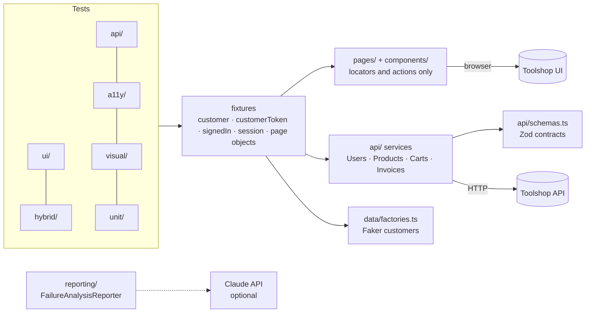

# Toolshop Playwright Framework

A layered test automation framework in **Playwright + TypeScript** for the
[Practice Software Testing "Toolshop"](https://practicesoftwaretesting.com) e-commerce app
and its [REST API](https://api.practicesoftwaretesting.com/api/documentation).

It covers the storefront end to end (UI, API, hybrid API⇄UI, accessibility and visual checks)
across Chromium, Firefox, WebKit and two mobile devices. It runs in GitHub Actions and Docker,
and a reporter classifies failed tests, optionally with Claude.

---

## Highlights

| What                       | How                                                                                                                                                                                                                        |
| -------------------------- | -------------------------------------------------------------------------------------------------------------------------------------------------------------------------------------------------------------------------- |
| **No hidden mocks**        | API services return the real `APIResponse`. There is no fallback that could turn a failing call into a pass.                                                                                                               |
| **Contract testing**       | Every response is checked against a [Zod](https://zod.dev) schema, one per endpoint representation (list, search and cart embed products differently). Drift fails with the exact field path.                              |
| **Isolated test data**     | Each worker registers its own customer through the API, using Faker data on `example.com`. Nothing depends on shared demo accounts; the public one was already locked out by other people's failed logins.                 |
| **API-seeded UI state**    | Tests sign in by injecting an API token, and build carts through the API before opening the UI. UI time goes only to the behaviour under test.                                                                             |
| **Hybrid assertions**      | The UI is compared against the API as the source of truth: search, category filter, product detail, cart totals, and orders placed in the UI showing up as invoices.                                                       |
| **Accessibility baseline** | axe-core (WCAG 2.1 A/AA) on key pages. Known issues are documented with reasons; any _new_ violation fails, and a fixed one must be removed from the list.                                                                 |
| **Known-defect tracking**  | A defect found while building the suite is kept as a `test.fail()` with an annotation, so the suite reports when it gets fixed.                                                                                            |
| **Failure triage**         | A custom reporter labels each failure as product bug, automation bug, environment issue or flaky test. It works offline with heuristics, or with Claude (structured JSON output) when enabled. Secrets are redacted first. |
| **Cross-browser + mobile** | Chromium, Firefox, WebKit, Pixel 7 and iPhone 15 projects.                                                                                                                                                                 |
| **Reproducible visuals**   | Visual baselines are produced and compared inside the official Playwright Docker image.                                                                                                                                    |

## Tech stack

Playwright 1.64 · TypeScript 6 (strict) · Zod 4 · Faker · axe-core · Allure · Anthropic SDK ·
ESLint (typescript-eslint + eslint-plugin-playwright) · Prettier · GitHub Actions · Docker

## Architecture



```
.
├── src/
│   ├── api/            # BaseApi, per-resource services, Zod schemas, status/contract assertions
│   ├── components/     # NavBar, ProductCard, CartRow
│   ├── config/env.ts   # .env loading (Node built-in), typed settings
│   ├── data/           # Faker factories: customers, unique emails, strong passwords
│   ├── fixtures/       # test.extend: worker-scoped customer, API-token sign-in, page objects
│   ├── pages/          # Home, Product, Login, Register, Account, Checkout (4-step wizard)
│   ├── reporting/      # failure-analysis reporter, heuristics, Claude analyzer, redaction
│   └── utils/          # money helpers, axe wrapper
├── tests/
│   ├── api/            # auth, products, carts, orders
│   ├── ui/             # auth, catalog, cart, checkout
│   ├── hybrid/         # API ⇄ UI consistency journeys
│   ├── a11y/           # WCAG baseline per page
│   ├── visual/         # component screenshots
│   └── unit/           # framework code (heuristics, redaction, money)
├── playwright.config.ts
├── Dockerfile · docker-compose.yml
└── .github/workflows/tests.yml
```

## Test inventory

| Project                           | Tests   | Scope                                                                                                                                |
| --------------------------------- | ------- | ------------------------------------------------------------------------------------------------------------------------------------ |
| `unit`                            | 14      | Framework logic: failure heuristics, secret redaction, money helpers                                                                 |
| `api`                             | 32      | Registration and auth rules, catalogue (pagination, sort, filters, search), carts, payments, orders, authorization between customers |
| `chromium`                        | 30      | UI (22), hybrid (2), accessibility (4), visual (2)                                                                                   |
| `firefox` / `webkit`              | 24 each | UI + hybrid (a11y and visual run on Chromium only)                                                                                   |
| `mobile-chrome` / `mobile-safari` | 4 each  | `@mobile` journeys on Pixel 7 and iPhone 15                                                                                          |

Tags: `@smoke`, `@regression`, `@api`, `@hybrid`, `@a11y`, `@visual`, `@mobile`, `@unit`.

## Getting started

Requires Node.js 22 or later.

```bash
npm ci
npx playwright install --with-deps   # browsers
cp .env.example .env                 # optional: defaults already target the live demo
```

| Command                                        | Runs                                          |
| ---------------------------------------------- | --------------------------------------------- |
| `npm test`                                     | Everything, all projects                      |
| `npm run test:chromium`                        | UI, hybrid, a11y and visual on desktop Chrome |
| `npm run test:api`                             | API suite (no browser)                        |
| `npm run test:smoke`                           | `@smoke` tests across projects                |
| `npm run test:mobile`                          | Mobile projects                               |
| `npm run test:a11y`                            | Accessibility baseline                        |
| `npm run test:visual` / `test:visual:update`   | Visual checks / refresh baselines             |
| `npm run typecheck` · `lint` · `format:check`  | Static checks                                 |
| `npm run report`                               | Open the HTML report                          |
| `npm run report:allure` / `report:allure:open` | Build / open the Allure report (needs Java)   |

### Configuration

| Variable            | Default                                   | Purpose                                                             |
| ------------------- | ----------------------------------------- | ------------------------------------------------------------------- |
| `BASE_URL`          | `https://practicesoftwaretesting.com`     | Storefront under test                                               |
| `API_URL`           | `https://api.practicesoftwaretesting.com` | API under test                                                      |
| `AI_ANALYSIS`       | `false`                                   | `true` sends failure details to Claude for triage                   |
| `AI_MODEL`          | `claude-opus-5-5`                         | Model used when AI analysis is on                                   |
| `ANTHROPIC_API_KEY` | –                                         | Credential for AI analysis (an `ant auth login` profile also works) |

**Bug-hunting mode:** point `BASE_URL` at `https://with-bugs.practicesoftwaretesting.com`
(the app's intentionally buggy build) and let the suite find what's broken.

## Design decisions

- **Token per test, not `storageState` per run.** Toolshop JWTs expire after five minutes, so a
  session saved once would expire part-way through a cross-browser run. The `signedIn` fixture logs
  in through the API (a few hundred milliseconds) and writes the token to `localStorage['auth-token']` before the
  app boots. Each value is written once per tab, so an in-app sign-out isn't undone on the next
  navigation.
- **Carts are seeded the same way.** The app keeps the cart in `sessionStorage['cart_id']`, so
  `session.useCart()` points the UI at a cart built through the API.
- **Billing addresses come from the API's own postcode lookup.** `POST /invoices` refuses any city
  that its lookup doesn't place in the given country, so real addresses such as Amsterdam, NL are
  rejected. That rule has its own test.
- **Failed-login tests use throwaway users.** Failed attempts lock accounts, so negative auth tests
  never touch the shared worker customer.
- **Grid reloads wait for the app's own markers.** Search, sort and filter use the HTTP `QUERY`
  method, which Playwright doesn't report responses for. The page objects wait for the
  `search_completed` / `sorting_completed` / `filter_completed` elements the app renders instead.
- **Test data comes from the API.** Stock and catalogue change on the live site, so tests pick a
  buyable product at runtime rather than hard-coding names or prices.
- **Locators** use the app's `data-test` attributes (`testIdAttribute: 'data-test'`). The two places
  without one (cart delete button, order confirmation) are commented where they're defined.

## Findings while building the suite

| Area                | Observation                                                                                                                                            | How the suite handles it                                              |
| ------------------- | ------------------------------------------------------------------------------------------------------------------------------------------------------ | --------------------------------------------------------------------- |
| Orders API          | A second `POST /invoices` for an already invoiced cart returns `201` and a new invoice number, so a double submit creates a duplicate order.           | `orders.api.spec.ts` · `test.fail()` with a `known defect` annotation |
| Accessibility       | `label-content-name-mismatch` (language button, all pages), `button-name` (icon button by the password field), `list` (filter and password-help lists) | Documented baseline in `tests/a11y`                                   |
| Shared demo account | `customer@practicesoftwaretesting.com` is locked by other users' failed logins                                                                         | Fresh customers are registered per worker                             |

## Reports

Every run writes to `reports/`:

- `html-report/`: Playwright HTML report with traces, screenshots and video on failure
- `junit.xml`, `results.json`: for CI integrations
- `allure-results/`: Allure input (`npm run report:allure`)
- `failure-analysis.md` / `.json`: one row per failed or flaky test with category, confidence,
  probable root cause and suggested fix. In GitHub Actions it is also added to the job summary.

### AI failure analysis

`src/reporting/FailureAnalysisReporter.ts` runs after the suite and never changes pass or fail.

- **Off (default):** deterministic heuristics classify failures (network or 5xx → environment,
  contract drift → product, strict-mode or locator timeout → automation, passed on retry → flaky…).
  Covered by unit tests.
- **On (`AI_ANALYSIS=true`):** each failure goes to Claude through the Anthropic SDK.
  `messages.parse` with a Zod output format guarantees the JSON shape. Error text is stripped of JWTs,
  bearer tokens and API keys first. Any API error, refusal or unparseable answer falls back to the
  heuristic for that test.

## CI/CD

`.github/workflows/tests.yml` runs on push, pull request, manual dispatch and a weekday schedule
(the target is a live site):

1. **static**: typecheck, ESLint, Prettier, unit tests
2. **api**: API suite
3. **browsers**: matrix of chromium, firefox, webkit, mobile-chrome and mobile-safari, each
   installing only the browser it needs
4. **visual**: screenshot comparison inside `mcr.microsoft.com/playwright:v1.64.1-noble`
5. **allure**: merges every job's results into one Allure report artifact

CI retries failed tests twice, and workers are capped to keep the load on the public demo polite.
Set the repository variable `AI_ANALYSIS=true` and the secret `ANTHROPIC_API_KEY` to enable AI triage.

## Docker and visual testing

```bash
docker compose run --rm tests           # full suite in the official Playwright image
docker compose run --rm visual          # visual checks only
docker compose run --rm visual-update   # (re)write Linux baselines used by CI
```

Screenshots differ between operating systems (fonts, anti-aliasing), so baseline names include the
platform (`login-form-chromium-linux.png`). CI compares against the Linux baselines produced by the
same image.

## Known limitations

- The target is a shared public demo: data, stock and response times vary, and orders created by the
  suite are real records there.
- Allure HTML generation needs a Java runtime (CI installs Temurin 21).
- AI triage needs Anthropic credentials and sends sanitized failure text to the Anthropic API.
